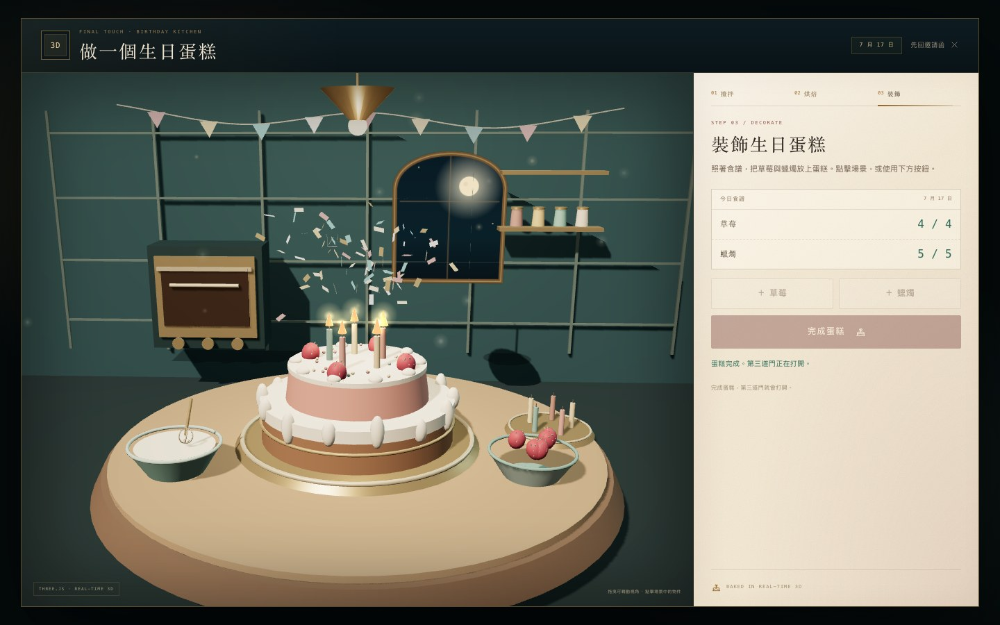

# 三關謎城 · The Three Gates

> 三道門，三種謎。答對，門才會開。

一個可直接在瀏覽器遊玩的單頁解謎遊戲，包含三道關卡：

| 關卡 | 題型 | 場景 |
| --- | --- | --- |
| I | 數學題 | 齒輪鐘樓 |
| II | 密室逃脫 | 無聲書房 |
| III | 生日謎題 + 3D 煮食 | 缺席的日期 → 生日廚房 |



## 執行方式

最簡單的方式：直接用瀏覽器開啟 `index.html`。

若想使用本機伺服器：

在專案資料夾執行：

```bash
python3 -m http.server 4173
```

再前往 <http://127.0.0.1:4173>。

不需要安裝任何套件，所有插畫、動畫、音效與邏輯都內建於這個資料夾，離線也能玩。

## 玩法

- 每一關都必須輸入／選出正確答案，門才會開啟；答錯不會前進。
- 第二關可點擊場景中的四個放大鏡蒐集線索，再輸入四位數密碼。
- 第三關先從日曆選出月份與日期；日期正確後會走進 Three.js 的 3D 生日廚房。
- 廚房裡要依序攪拌麵糊、送進烤箱，再照食譜放上草莓與蠟燭，完成蛋糕後第三道門才會開啟。
- 廚房中可點擊 3D 場景裡的鋼盆、烤箱與食材，也可以使用右側／下方的按鈕；臨時離開廚房後可以再回來繼續。
- 卡住時可使用每關兩段提示；提示不影響能否過關。
- 右上角可切換音效、重新開始。通關時間與最佳紀錄會存在瀏覽器的 `localStorage`。

## 特色

- 全自製的 2D SVG 場景與 Three.js 3D 廚房，沒有外部圖片或字型依賴。
- **三關題目都會在每次重新開始時重新生成**：數學數值、密室四位數密碼／場景線索／紙條順序、生日乘積／加總與正確日期都不固定。
- **第三關包含真實 3D 煮食小遊戲**：以 Three.js 建立即時光影的生日廚房，包含攪拌、烘焙、草莓與蠟燭裝飾；蛋糕食譜會依當局生日日期變化。
- 答對才過關的關卡閘門、錯答震動回饋、提示抽屜、轉場動畫、通關彩紙。
- WebGL 無法使用時會顯示提示，仍可用按鈕完成煮食流程。
- Web Audio 即時合成音效，無音訊檔案。
- 支援手機、平板與桌機；鍵盤操作與 `prefers-reduced-motion`。
- 通關成績可一鍵複製分享。

## 專案結構

```
.
├── index.html          # 頁面、三關場景、3D 廚房介面
├── styles.css          # 視覺系統、場景樣式、響應式版面與動畫
├── app.js              # 遊戲狀態、出題、線索、日期選擇、音效與轉場
├── kitchen.js          # Three.js 生日廚房：3D 場景、煮食步驟與互動
├── vendor/
│   └── three.min.js    # Three.js r149（MIT，本地內嵌，離線可用）
├── preview-kitchen.jpg
└── README.md
```

## 想改題目？

- **數學題**：修改 `app.js` 裡的 `makeMathPuzzle()`，保持三個符號有唯一解即可。
- **密室密碼**：修改 `makeRoomPuzzle()` 的隨機範圍，以及 `buildRoomClues()` 對應的線索文字。場景中的書背數字、白鴿、時針、彈珠與紙條順序會由 `applyRoomPuzzle()` 同步更新。
- **生日日期**：修改 `makeBirthdayPuzzle()`。目前刻意讓「日期大於 12」，確保乘積／加總只會指向唯一一組月、日；若改動規則，請保留這個唯一性。
- **蛋糕與 3D 廚房**：`cakeRecipeFor()` 會依日期算出草莓與蠟燭數量；3D 場景、物件、光影與煮食動畫都在 `kitchen.js`。`styles.css` 末尾是廚房介面的樣式。

---

<details>
<summary>卡關時的解題方向（沒有固定答案）</summary>

1. **齒輪鐘樓**：由前三行依序解出齒輪、鑰匙、蠟燭；最後一行記得先乘除、後加減。
2. **無聲書房**：依照紙條上這一局重新排列的順序（例如「鐘→畫→抽屜→書」）取出四個數字。書背是羅馬數字；白鴿、時針、彈珠的數量都在場景與線索裡。
3. **缺席的日期**：把邀請函上的乘積拆成兩個整數相乘，找到相加等於邀請函第二個數字的那一組。因為日期大於 12，答案只會有一組。
4. **生日廚房**：依序按「攪拌一下」五次、送進烤箱，再依照食譜計數放上草莓與蠟燭。3D 場景沒有亮起時，使用按鈕也能完成。

</details>


## GitHub Pages

專案的 `main` 分支根目錄即為靜態網站來源；每次推送或合併到 `main`，GitHub Pages 會自動重新部署。

<https://s20250051-cpu.github.io/ting123/>
